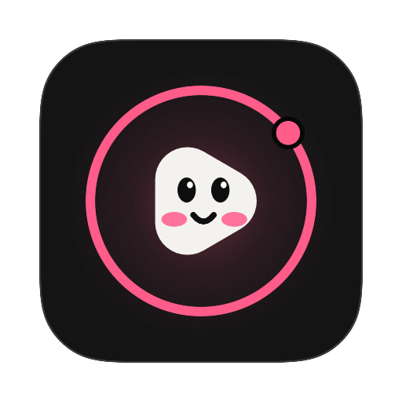

<p align="center"></p>

# WallLoop

Live video wallpapers for macOS, made from your own videos.

**WallLoop — by Riven.** Carved by Johnbosco J Elanjikal, founder of Riven. Built by RivenDevs.

Put videos in a folder, give WallLoop access to it, and your desktop plays them on a loop,
muted and hardware-decoded, one window per display. WallLoop lives in the menu bar, and it's free
and open source.

> **Status:** 0.1.0 preview. The preview DMG on [GitHub Releases](https://github.com/johnbosco-j/WallLoop/releases)
> isn't notarized yet (see [Install](#install)); signed, notarized builds follow once the Developer ID
> is set up. Product page: [`site/`](site/), reached from `rivendevs.in/wallloop`.

<!-- Screenshots: add these files, then remove this comment.


-->

## Features

- **Your videos as the wallpaper.** MP4, MOV and M4V play muted and looping behind your desktop
  icons, on every display and every Space.
- **Every display.** The same video everywhere, or a different one on each display. WallLoop follows
  displays as you connect, disconnect or rearrange them.
- **Fill, Fit or Stretch**, just like the system's own wallpaper settings.
- **Lock screen that matches.** Each time the video changes, a still frame becomes the desktop
  picture, so the lock screen and login window show the same scene.
- **Shuffle or in order**, changing every 5, 15 or 30 minutes, every 1 or 3 hours, daily, or never.
  Shuffle plays every video once before repeating.
- **Menu bar controls:** Previous, Next and Pause, with the current video's thumbnail, its name and,
  when paused, the reason.
- **Favorites:** heart the current video, play any favorite from the Favorites submenu, or shuffle
  favorites only.
- **Drop to add:** drop videos on the menu bar icon to copy them into Movies › WallLoop and play them
  right away; drop a folder to add it to your library without copying.
- **Light on battery:** hardware-decoded playback that never keeps your display awake.
- **Automatic updates** through Sparkle.
- **Any folders you choose.** Movies › WallLoop is always included; add more folders and WallLoop
  remembers them (read-only, security-scoped bookmarks). Removing a folder never deletes files.
- **Live library.** Add or delete videos in Finder and WallLoop updates within a second; if the video
  on screen disappears, it moves on.
- **Hardware decoding only.** Videos your Mac can't decode in hardware (for example AV1 on M1/M2, or
  VP9) are listed under "Can't Play" with the reason instead of draining your battery.
- **HEVC with alpha.** Transparent areas show your desktop picture through the video.
- **Pauses itself.** Always while the screen is locked, the displays or Mac are asleep, or another
  user is active; and, unless you turn it off, on battery power, in Low Power Mode, and when
  full-screen apps or windows cover every display. The menu shows why it's paused, playback resumes
  where it left off, and the shuffle timer waits.
- **Library grid** in Settings: thumbnails, click to play, right-click to favorite, show in Finder,
  hide or move to Trash, search, a favorites filter, and drag and drop of videos or folders.
- **Open at Login** through macOS's own login-item service (`SMAppService`), not a LaunchAgent.
- **Global keyboard shortcuts**, changeable in **Settings › Shortcuts**, with no Accessibility
  permission needed:

  | Action | Default |
  | --- | --- |
  | Next wallpaper | ⌃⌥⌘→ |
  | Previous wallpaper | ⌃⌥⌘← |
  | Pause or play | ⌃⌥⌘P |

## Install

1. Download `WallLoop.dmg` from the WallLoop page (`rivendevs.in/wallloop`) or
   [GitHub Releases](https://github.com/johnbosco-j/WallLoop/releases/latest).
2. Open the DMG and drag **WallLoop** onto **Applications**.
3. Open WallLoop from Applications. It has no Dock icon: look for its icon in the menu bar.
4. Add your videos. Put them in **Movies › WallLoop** (WallLoop creates the folder on first launch),
   or choose another folder in **Settings › Library**. WallLoop can only read the folders you
   choose.

**Preview builds aren't notarized yet**, so the first time you open WallLoop macOS says it can't
verify the developer. Click **Done**, then open **System Settings › Privacy & Security**, scroll down
and click **Open Anyway** next to WallLoop, and confirm. You only do this once. Signed, notarized
releases open without this step.

Requires macOS 14 Sonoma or later. On macOS 26 and later, WallLoop uses Liquid Glass.

## Design

WallLoop follows Riven's design system (`rivendevs-site/design.md`): Riven's dark neutrals,
Instrument Sans with Instrument Serif italic accent words, DM Mono labels, its spacing, radii and
motion, and the orbit motif. Like every Riven product it keeps its own accent colour, WallLoop
rose `#FF5C8A`, used sparingly with black text on it. The tokens live in
[`Sources/Design/Theme.swift`](Sources/Design/Theme.swift) and the logo in
[`Sources/Design/BrandMark.swift`](Sources/Design/BrandMark.swift); the website mirrors them in
[`site/styles.css`](site/styles.css).

## Privacy

WallLoop has no analytics, no tracking and no accounts. It reads only the folders you choose, and
your videos, settings and thumbnails never leave your Mac.

Its only network access is Sparkle's update check, which downloads the appcast and updates from
the URL configured at build time. You can turn automatic checks off in **Settings › About**.

## Performance

WallLoop decodes video with the Mac's media engine (VideoToolbox, via AVFoundation) and skips
files that would need software decoding.

| Situation | Measured |
| --- | --- |
| Playing one H.264 video, one 1710×1112 display, Apple silicon MacBook | ~1.8% CPU (Activity Monitor/`top`), 18 MB memory |
| Paused (any reason) | ~0% CPU: decoding stops, the last frame stays on screen |

- Displays showing the same video share one decoder, so a second display adds only compositing.
- The display can always sleep: playback never holds a display-sleep assertion.
- GPU and package power: measure on your own hardware with
  `sudo powermetrics --samplers cpu_power,gpu_power -i 5000` while a video plays, and compare with
  WallLoop paused.

## Build from source

You need Xcode 26 or later and [XcodeGen](https://github.com/yonaskolb/XcodeGen)
(`brew install xcodegen`).

The Xcode project is generated from `project.yml` and isn't checked in. Regenerate it whenever you
add or remove files, or change `project.yml`:

```bash
xcodegen generate
```

Build (Debug):

```bash
xcodebuild -project WallLoop.xcodeproj -scheme WallLoop -configuration Debug -derivedDataPath build/DerivedData build
```

Run the unit tests:

```bash
xcodebuild -project WallLoop.xcodeproj -scheme WallLoop -derivedDataPath build/DerivedData test
```

Launch the app you just built:

```bash
open build/DerivedData/Build/Products/Debug/WallLoop.app
```

Opening the app again while it runs shows the Settings window.

Every push and pull request is built and tested on GitHub Actions (`.github/workflows/build.yml`).

### Signing for development

Out of the box, builds are signed ad hoc ("Sign to Run Locally") so they work on any Mac without an
Apple Developer account. To sign with your team, create `Config/Local.xcconfig` (it's gitignored):

```
DEVELOPMENT_TEAM = ABCDE12345
CODE_SIGN_STYLE = Automatic
CODE_SIGN_IDENTITY = Apple Development
```

### Project layout

| Path | What's in it |
| --- | --- |
| `project.yml` | XcodeGen spec: the `WallLoop` app, its Sparkle package, and the unit tests |
| `Config/` | Info.plist, entitlements, shared build settings (including the Sparkle feed URL and key) |
| `Sources/App` | Entry point, app delegate, and `AppModel`, which connects library, scheduler and engine |
| `Sources/Settings` | `SettingsStore`: preferences saved in `UserDefaults` |
| `Sources/Engine` | `WallpaperEngine`: one desktop-level window per display, shared looping players, lock screen stills |
| `Sources/Library` | `Library`: the videos WallLoop can play |
| `Sources/Scheduler` | `Scheduler`: shuffle deck, in-order playback, history for Previous |
| `Sources/MenuBar` | `MenuBarController`: the status item and its menu |
| `Sources/SettingsWindow` | SwiftUI Settings window (Library, General, About) |
| `Sources/Updates` | `Updater`: Sparkle auto-updates |
| `Sources/Design` | Riven theme tokens, components, the Loopy logo, Liquid Glass helpers |
| `Sources/Resources` | Asset catalog and app icon |
| `Tests/` | Unit tests (Swift Testing) |
| `scripts/` | `release.sh`, `render-brand.sh` (icon layers, DMG background), `dmg/` (DMG layout) |
| `site/` | The WallLoop product page (static; see [`site/README.md`](site/README.md)) |

The app is sandboxed with Hardened Runtime. Its entitlements allow reading folders you choose,
remembering them, the Movies folder, outgoing network connections (Sparkle only), and Sparkle's
installer services.

## Releasing

WallLoop ships as a Developer ID-signed, notarized DMG with Sparkle updates. It isn't on the Mac App
Store. `scripts/release.sh` does the whole build: archive, export, verify, notarize, staple, DMG,
sign, notarize the DMG, and update the appcast.

### One-time setup

1. **Join the [Apple Developer Program](https://developer.apple.com/programs/)** (paid, yearly).
2. **Create a Developer ID Application certificate.** In Xcode, open Settings › Accounts, select
   your team, click Manage Certificates, then + › Developer ID Application. Check that it's in your
   keychain:
   ```bash
   security find-identity -v -p codesigning
   ```
3. **Find your Team ID** under Membership details at
   [developer.apple.com/account](https://developer.apple.com/account).
4. **Save notarization credentials.** Create an app-specific password at
   [account.apple.com](https://account.apple.com) (Sign-In and Security › App-Specific Passwords),
   then store it in your keychain under a profile name. It asks for the password:
   ```bash
   xcrun notarytool store-credentials wallloop-notary --apple-id you@example.com --team-id ABCDE12345
   ```
5. **Create the Sparkle update signing key.** Build once so Swift Package Manager downloads Sparkle,
   then run its `generate_keys`. It saves the private key in your login keychain and prints the
   public key:
   ```bash
   build/DerivedData/SourcePackages/artifacts/sparkle/Sparkle/bin/generate_keys
   ```
   Back up the private key somewhere safe (`generate_keys -x wallloop-sparkle-private-key`). If
   you lose it, existing users can't install updates.
6. **Point the app at your appcast.** Add to `Config/Local.xcconfig`. Write `https:/$()/` instead
   of `https://`, because `//` starts a comment in xcconfig files:
   ```
   APPCAST_URL = https:/$()/your-site.example/wallloop/appcast.xml
   SPARKLE_PUBLIC_KEY = the-public-key-printed-by-generate_keys
   ```
   Until these are set, the updater stays off and "Check for Updates…" is disabled.
7. **Pick a download folder on your site**, served over HTTPS. The appcast, DMGs and delta updates
   all live there.

### Each release

1. Bump `MARKETING_VERSION` (for example `0.2.0`) and `CURRENT_PROJECT_VERSION` in `project.yml`.
   The build number must go up every release, because Sparkle compares it.
2. Move the `Unreleased` notes in `CHANGELOG.md` under the new version. Optionally write release
   notes as `dist/updates/WallLoop-0.2.0.html`, and Sparkle shows them in the update window.
3. Run the release script:
   ```bash
   TEAM_ID=ABCDE12345 NOTARY_PROFILE=wallloop-notary DOWNLOAD_URL_PREFIX=https://your-site.example/wallloop/ scripts/release.sh
   ```
4. Upload `dist/WallLoop-0.2.0.dmg`, `dist/updates/appcast.xml` and any new `.delta` files from
   `dist/updates/` to that folder on your site. Keep `dist/updates/` between releases, because
   Sparkle builds the feed and delta updates from the DMGs in it.
5. Tag the release:
   ```bash
   git tag v0.2.0 && git push origin v0.2.0
   ```

Options: `VERSION` and `BUILD` override the version, `SIGN_IDENTITY` picks a specific certificate,
`SPARKLE_BIN` points at Sparkle's tools, and `DMG_NAME` overrides the DMG file name. The DMG window is laid out by [dmgbuild](https://github.com/dmgbuild/dmgbuild) (installed into `build/tools` on first run), so no Finder permission is needed.

To check the build and DMG without an Apple Developer account, make an unsigned test DMG. Never
upload it:

```bash
ADHOC=1 scripts/release.sh
```

### App icon and DMG artwork

The icon is drawn in code, in `Sources/Design/BrandMark.swift`: Loopy, a smiling play button, inside
a rose orbit ring on Riven's dark surface. `scripts/render-brand.sh` renders it into the layers of
`Sources/Resources/AppIcon.icon`, an Icon Composer document that macOS 26+ shows with Liquid Glass.
Xcode renders the `.icns` for macOS 14–15 from the same file, glass shading included, so there is no
separate PNG icon set. The script also renders the DMG background (`scripts/dmg/background.tiff`).
Run it again after changing the logo:

```bash
scripts/render-brand.sh
```

To replace the artwork by hand, open `Sources/Resources/AppIcon.icon` in Icon Composer
(Xcode › Open Developer Tool). Layers are 1024 × 1024 px PNGs on the macOS icon grid.

## Website

`site/` is WallLoop's product page, live at **https://wallloop.vercel.app**: plain HTML, CSS and a
little JavaScript, no build step. Its
Download buttons point at `releases/latest/download/WallLoop.dmg`, so every release must attach a
file named exactly `WallLoop.dmg`, and the repository must be public for visitors to download it.
It's the Vercel project `wallloop` (Root Directory `site`), which redeploys when `site/` changes;
the Riven site's `/wallloop` short link redirects there. Details in [`site/README.md`](site/README.md).

## Labs: live video on the lock screen

On macOS 14 and later the lock screen shows your desktop picture. Each time the wallpaper changes,
WallLoop sets a still frame from the current video as the desktop picture on every display, so the
lock screen matches what was playing. Only the lock screen itself is still.

A *moving* lock screen would need macOS's wallpaper extension point (`com.apple.wallpaper`). That is
built on Apple's private `WallpaperExtensionKit` framework and an undocumented protocol between
the extension and macOS's wallpaper agent, with no public headers or documentation. Using it means
reverse engineering that protocol, could break in any macOS update, and could leave the lock screen
black if something went wrong. WallLoop doesn't do that. The full research and a checklist for re-checking each macOS release are in
[docs/lock-screen-research.md](docs/lock-screen-research.md). If Apple publishes a real API, WallLoop
will add it as an opt-in Labs feature.

## Legal

WallLoop plays only videos you already have. It doesn't bundle, download or scrape any wallpaper
content, and it doesn't use any other wallpaper app's servers or code. The "Get Free Wallpapers"
menu only opens [Pexels](https://www.pexels.com/videos/), [Pixabay](https://pixabay.com/videos/)
and [Mixkit](https://mixkit.co/free-stock-video/) in your browser. Check each site's license
before you use a video.

## Acknowledgements

- [Sparkle](https://sparkle-project.org) for updates (MIT).
- [KeyboardShortcuts](https://github.com/sindresorhus/KeyboardShortcuts) by Sindre Sorhus (MIT).
- [Instrument Sans](https://fonts.google.com/specimen/Instrument+Sans),
  [Instrument Serif](https://fonts.google.com/specimen/Instrument+Serif) and
  [DM Mono](https://fonts.google.com/specimen/DM+Mono), under the SIL Open Font License (bundled
  with their licence files in `Sources/Resources/Fonts`).
- [dmgbuild](https://github.com/dmgbuild/dmgbuild) lays out the DMG (MIT; a build tool, not shipped).

## License

WallLoop is released under the [MIT License](LICENSE). © 2026 Riven · Chennai, India.
